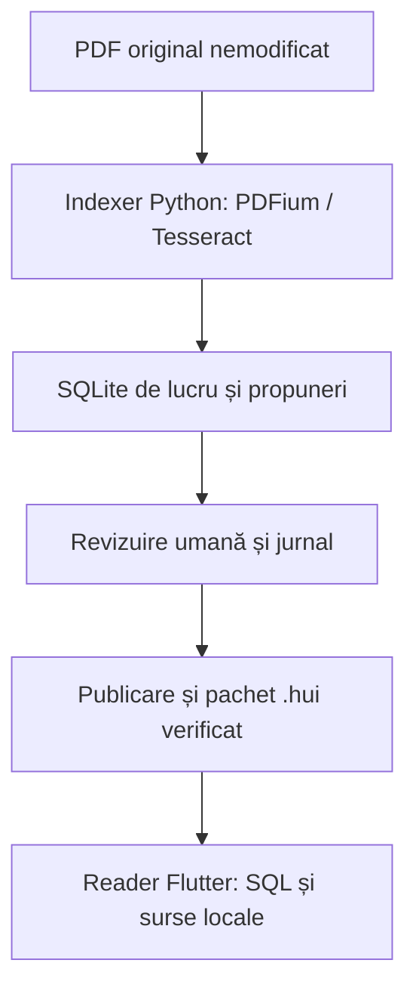

# Arhitectură

HUI este un prototip local-first cu două procese independente. Reader nu lansează Python și nu depinde de un serviciu local.

Indexer conține importul reluabil pe pagini, schema, API-ul manual de adnotare, CLI, atelier Tk, validarea și exportul. Furnizorii opționali AI sunt exclusiv în `indexer/providers.py`; niciun model nu pornește prin importul unui document sau prin deschiderea GUI.

Reader deschide SQLite read-only, folosește SQL parametrizat și FTS5, păstrează filtrele și traseul navigării și afișează imagini originale plus PDF-ul cu pdfrx. Interogările și importul sunt executate în izolate Dart pentru a evita blocarea interfeței. Listele de metadate și detaliile mici folosesc citiri sincrone.

Biblioteca existentă HistoryLab este independentă. Nu există o migrare automată din IndexedDB/JSON în SQLite; adăugarea unui asemenea convertor necesită reguli separate de validare a coordonatelor.

## Publicare

Toate modificările semantice folosesc tranzacții/savepoint-uri. Un lot invalid este respins integral. Publicarea verifică integritatea, existența dovezilor și terminarea extragerii înainte de a crea o versiune. Exportul folosește API-ul SQLite backup pentru un instantaneu consistent; manifestul citește versiunea din acel instantaneu. Propunerile rămân etichetate și pot fi inspectate; căutarea semantică implicită folosește numai indici și apariții confirmate uman.

Importul Reader validează în director nou, apoi schimbă pointerul către colecția activă. Nu suprascrie baza deschisă. Versiunea anterioară rămâne pe disc și este referită de pointerul de backup.

## Scalabilitate

FTS5, indici pentru proveniență și relații, rezultate paginate și importul incremental evită reconstruirea întregului corpus la fiecare carte. OCR se face pe câte o pagină. Coordonatele digitale se păstrează la nivel de caracter, ceea ce poate mări considerabil baza. Benchmark-ul livrat măsoară numai interogarea textuală a unei baze sintetice de 10.000 de segmente; nu validează performanța OCR sau colecții de mii de cărți.
